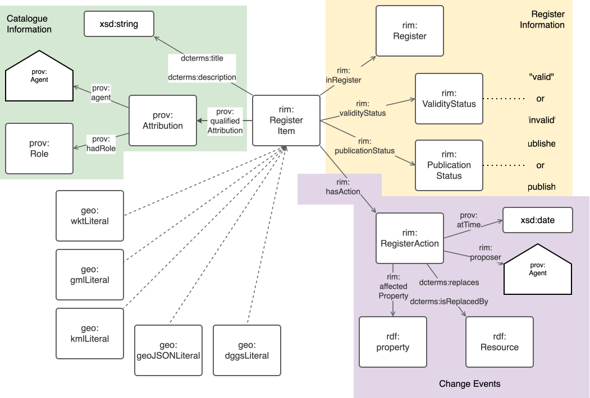
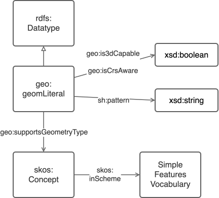

# GeoSPARQL Geometry Datatypes Register

This is a register of RDF literal datatypes that can be used to represent the serialization of a GeoSPARQL 
`geo:Geometry` object.

Originally GeoSPARQL 1.0 in 2012 contained just two allowed such datatypes: 
[Well-known text( (WKT)](https://en.wikipedia.org/wiki/Well-known_text_representation_of_geometry) and 
[Geography Markup Language (GML)](https://en.wikipedia.org/wiki/Geography_Markup_Language). 

GeoSPARQL 1.1 in 2024 contained 5:

* WKT
* GML 
* [Keyhole Markup Language (KML)](https://en.wikipedia.org/wiki/Keyhole_Markup_Language)
* [GeoJSON](https://en.wikipedia.org/wiki/GeoJSON)
* [Discrete Global Grid System (DGGS)](https://en.wikipedia.org/wiki/Discrete_global_grid)

After 1.1, GeoSPARQL has moved to store allowed geometry literal datatypes in this register so that it may grow out of
step with revisions of the GeoSPARQL standard.

## Register Information

### Context

Geometry literals are used within GeoSPARQL as per the following figure:


### Register Information

These datatypes are managed in this register according to [ISO19135:2016](), the information representation model for which is the OGC's [Registered Item Model (RIM)]().

RIM information per geometry literal - a `Regster Item` - is as per the following figure:



### Domain

The domain information for these objects is as per the following figure:



> [!WARNING]  
> The predicates in the figure above are currently - October 2026 - speculative and have not yet been added to the 
> [GeoSPARQL Ontology](http://www.opengis.net/ont/geosparql)

## Technical Operations

These resources are organized and can be synchronized to the OGC's [Definitions Service](https://defs.opengis.net/)
using [KGM](https://github.com/Kurrawong/kgm) which is a tool that reads repository content and loads it into an RDF 
database.

KGM reads the `manifest.ttl` file, discovers the resources linked to from there, validates them and then synchronizes 
them with a target RDF DB via _Graph Store Protocol_ commands like this:

```bash
kgm sync manifest.ttl
```

## License & Rights

All the content of this repository is licensed for use under the 
[Apache Software License 2.0](https://www.apache.org/licenses/LICENSE-2.0) license, as per standard OGC practice for 
software.

## Contact

This register's _Register Manager_ is currently the:

**GeoSPARQL Standards Working Group**  
Please contact the GeoSPARQL SWG using
[details on its main repo](https://github.com/opengeospatial/ogc-geosparql/#contact).

The _Register Owner_ is the [Open Geospatial Consortium](https://www.ogc.org).